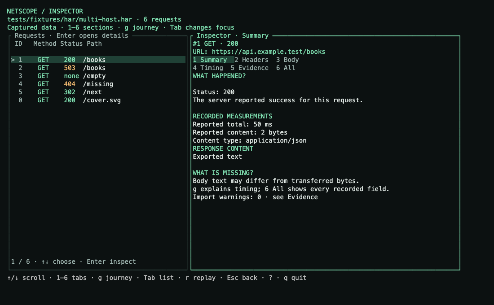

# Netscope

Inspect recorded web requests and network packets in your terminal. See what was sent, what came back, and what the recording leaves out. Prepare an edited request and review it before sending.



The inspector above shows an invented sample capture included in the repository.

## Install and start

Install [Rust](https://rustup.rs/) 1.92 or newer, then run:

```sh
cargo install netscope --locked
netscope capture.har
```

Replace `capture.har` with the path to a HAR file exported from your browser's developer tools. Cargo builds Netscope on your machine. The [installation guide](docs/INSTALLATION.md) explains setup and includes a sample you can download.

## Inspect a capture

Select a request with the arrow keys and press Enter to inspect it. Press `?` for help and `q` to quit. You can search URLs, read headers and bodies, and explore recorded timings with explanations alongside them.

For a classic PCAP packet recording, use `netscope --pcap capture.pcap`. The stream view shows where bytes are missing or disagree. PCAPNG and decryption of encrypted traffic are not supported.

## Prepare a request

Press `r` while inspecting a supported request to create an editable draft. Review its destination, headers, and body before sending. Opening a file never sends traffic.

Replay supports GET and POST requests. See the [usage guide](docs/UI_LAYOUT.md) for controls and the [local walkthrough](docs/DEVELOPMENT.md#try-a-local-send) for a server you can safely experiment with.

## Learn and contribute

The [book](docs/README.md) teaches Rust and networking through Netscope, assuming no Rust knowledge. It explains ownership, error handling, concurrency, and the reasons behind the design, then brings those ideas together in a capstone.

To work on the project, start with [contributor instructions](docs/DEVELOPMENT.md). See the [release notes](CHANGELOG.md) for version changes.

## License

Netscope's original code and documentation are available under [MIT](LICENSE-MIT) or [Apache 2.0](LICENSE-APACHE), at your option. Separately attributed material retains its own license.
